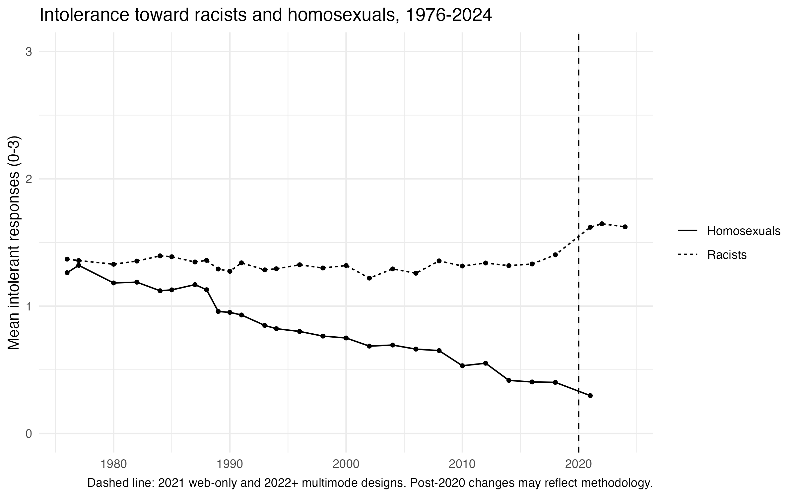
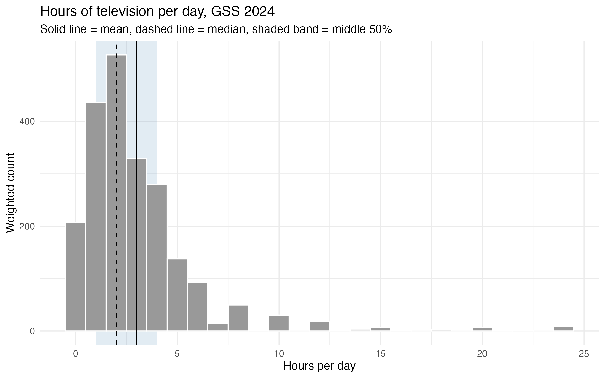
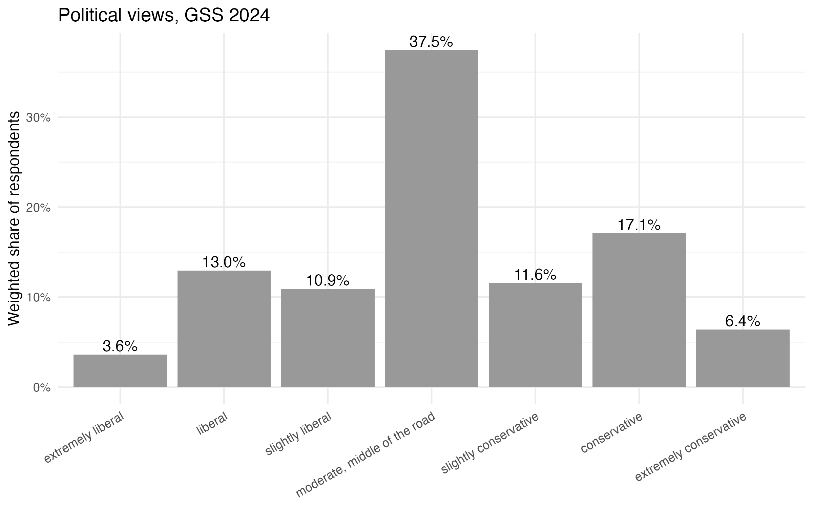

# Replication, 1976-1998

{#fig-rep1 width=90%}

{#fig-rep2 width=90%}

{#fig-rep5 width=90%}

# Extension through 2024

Changes in opinions, attitudes, and behaviors observed in 2021, 2022, and 2024 relative to historical trends may be due to actual change in concept over time and/or may have resulted from methodological changes made to the survey methodology during the COVID-19 global pandemic.

{#fig-ext1 width=90%}

{#fig-ext2 width=90%}

{#fig-ext5 width=90%}

# Original Work: Two GSS Variables

{#fig-tv width=90%}

{#fig-pv width=90%}

# Questions

## 1. Where did you encounter problems with this replication? Was there anything that was particularly tricky?
I had a lot of trouble with this problem set. Whether it was human error or not knowing how to put certain pieces together, it definitely challenged me to look for answers online. The data itself caused problems. My first attempt to load the file failed because I used `read.csv()` on a Stata file, and I had to switch to `read_dta()`. Once the data loaded, I learned that the response codes are not consistent across items. The speech items use 1 and 2, the teaching items use 4 and 5, and the library items use 1 and 2 but with 1 meaning "remove the book." The Communist teaching item was also reversed, since it asks whether the person should be fired, so 4 is the intolerant answer instead of 5. On top of that, "don't know" answers are stored as a special type of missing value, and I had to make sure they were counted as intolerant to match the paper. I also had to decide how to handle respondents who were missing an item. I built each scale by adding the items with +, which returns a missing score if any item is missing, so a respondent only receives a score if they answered every item in that scale. This keeps every score on the same 0 to 15 or 0 to 9 range, but it also means the sample in each year depends on which items were asked that year. From 2021 to 2024, the GSS ran a gender-neutral wording experiment, so half the sample answered a separate "y" version of several items, and I had to combine the two versions. One of these, COLCOMY, uses 1 and 2 instead of the 4 and 5 used by COLCOM. Four other "y" variables (SPKMILY, LIBMILY, SPKHOMOY, and LIBHOMOY) were not listed in the 2024 codebook at all, and leaving them out cut the 2021 sample for the 15-item scale in half until I found them in the full variable list. I tend to write comments that make sense to me but do not break the code down for the next person. I noticed this when I asked a friend to look at my code and they were confused, so I found it surprisingly difficult to translate my comments into a more understandable format. Using the `|>` pipe was also odd to me at times. I remember in class you mentioned not to let it become repetitive with multiple "and"s, but I found myself doing it unconsciously because of how simple it was to just add another "and." Another difficulty was researching how to code more efficiently. Even small techniques made a difference, and I will say YouTube and Tiktok are very helpful when it comes to quick tricks. I also noticed that my result for intolerance toward racists in 1985 came out to 1.42, while the paper's Figure 2 labels it 1.43. Every other benchmark matched exactly, so I treated this as rounding rather than a coding error. The paper only reports values as labels on its figures, not as a full table, so a difference in the second decimal place can't be resolved further.

## 2. How would you interpret (in other words, explain to a general audience) what Mondak and Sanders found in Figures 1, 2, and 5?

Across the 1976 to 1998 GSS, Americans became noticeably more willing to extend civil liberties to unpopular groups on average. They were asked 15 questions about whether certain groups should be allowed to speak, teach, or have their books in public libraries. What's interesting is that the average number of intolerant answers dropped from 7.24 in 1977 to 5.28 in 1998 (Figure 1). This change shows that Americans were becoming less intolerant over time. They were more willing to let people they might not agree with have their say and be part of society.

That average conceals two different stories. If we look closer at Figure 2, we can see that people's attitudes changed in different ways towards different groups. For example, people became more accepting of homosexuals, with intolerance toward them decreasing by 44%. But when it came to racists, people's intolerance only decreased by 8%. This suggests that the overall trend was driven largely by the public warming toward particular groups rather than by a broad embrace of free expression for everyone. Figure 5 reinforces this point. The share of respondents who gave at least one intolerant answer barely changed, staying between 82% and 85% through 1989 and between 79% and 82% through 1998. In other words, most Americans were still okay with restricting some groups, but what changed was how many groups they wanted to restrict and which ones. So, it's not like people suddenly became super tolerant; they just changed their minds about certain groups. Mondak and Sanders therefore argue that tolerance and intolerance should be treated as distinct: becoming less intolerant toward some groups is not the same as becoming a tolerant person.

## 3. Has anything changed since 1998 that would alter the substantive takeaway points in their findings?

If we look at the average score over nine items, it kept going down after 1998, hitting a low of around 3.01 in 2016. But then it started going up again, reaching about 3.58 by 2024 (Figure 1 Extended). The group-level trends in Figure 2 Extended show why. People became more accepting of homosexuals over time, with intolerance levels dropping to around 0.33 by 2021. But when it came to racists, things were different. Intolerance stayed pretty steady at around 1.3 until 2018. Then it suddenly jumped up to around 1.62 to 1.65 from 2021 to 2024. This is actually what Mondak and Sanders predicted would happen: overall, people's intolerance levels tend to follow how they feel about specific groups, and it can increase if a group starts to get more hate. Meanwhile, the share of respondents giving at least one intolerant answer stayed high, about 0.75 in 2018 and 0.81 to 0.84 from 2021 to 2024 (Figure 5 Extended). The decades of declining averages never produced a population that was broadly tolerant.

